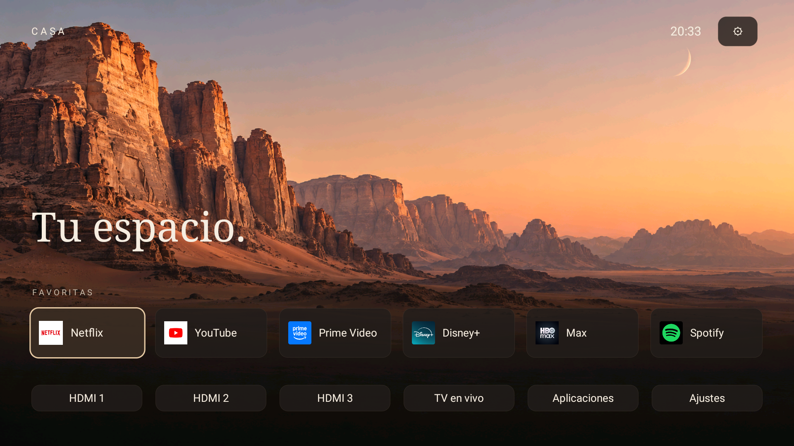

# Casa Aura TV

**A calmer home for your TV.** An independent Android TV / Google TV launcher with favorites, HDMI shortcuts and an ambient screensaver.

Developed and tested specifically on **TCL 50C645 / Android 11 / V652**. Previously called Casa TV Launcher; the repository, package and signing identity are retained for compatible updates. See the [C645 results journal](docs/RESULTADOS-C645.es.md) and [Guard protection guide](docs/TCL-C645-GUARD.es.md), currently in Spanish. The APK does not apply those TV policy changes automatically.

**0.4 pre-release:** a native card-based control center and compact centered dialogs, preserving Casa's existing artwork. Native TCL panels are unchanged; no TV-wide speedup is claimed.

**Current release: 0.7.0.** Choose Classic, Modern or Immersive under Appearance. Ambient mode includes three landscapes, rotation, cut/fade and optional zoom. Favorites and legacy backups are retained. Version 0.7 adds an optional, manually downloaded GitHub gallery with bounded local storage. [Gallery guide (Spanish)](docs/GALERIA.es.md). [Design and ambient guide (Spanish)](docs/DISENOS-AMBIENTE.es.md).

[Download APK / releases](https://github.com/arleyjesus/casa-tv-launcher/releases) · [Español](README.md) · [Compatibility](docs/COMPATIBILITY.md)

## Features

- An ad-free home interface without Casa accounts. INTERNET is used only for manually requested GitHub wallpaper downloads.
- Up to six editable, reorderable favorites and an installed-app list.
- HDMI shortcuts and a panel linking to the TV's original settings.
- Static cinematic wallpaper, clock and optional focus animation.
- Local settings backups and restore.
- Ambient preview and an Android screensaver service, without a PIN.

Casa does **not** require Projectivy or root. Keep the original Google TV launcher enabled. It does not block advertising inside other apps or alter their interfaces.

## Tested device and compatibility

Native TCL panel stutter remains unresolved. This release changes Casa and does not establish a TV-wide speedup.

Tested on **TCL 50C645, Android 11, firmware V8-R51MT05-LF1V652.021344**. The manifest supports API 26+, but other devices are unverified. HDMI/settings integration is TCL-specific and three HDMI inputs are offered in the input menu. The UI is currently Spanish-only.

Download the APK from [Releases](https://github.com/arleyjesus/casa-tv-launcher/releases), install and test it as a normal app first. Enable the optional **Casa Aura · Botón Inicio** accessibility service only if you want Home redirection. See the [installation guide](docs/INSTALL.es.md) for ADB examples, TCL auto-start, screensaver configuration and rollback. No debloat list is required.

The accessibility service only receives window-state events for the Google TV and Projectivy home screens; it cannot read window contents or intercept keys. [Privacy](docs/PRIVACY.md).

## Build, report and share

[Build instructions](docs/BUILD.md) · [Contributing](CONTRIBUTING.md) · [Roadmap](ROADMAP.md) · [Changelog](CHANGELOG.md).

Report your device, firmware and reproduction steps in [Issues](https://github.com/arleyjesus/casa-tv-launcher/issues). Do not upload private TV dumps, accounts, IP addresses or credentials.

MIT licensed. Original artwork was created with AI assistance. Third-party names and icons remain their owners' property. No affiliation with TCL, Google, Projectivy or streaming services. The official release signing key is not included in this repository.
