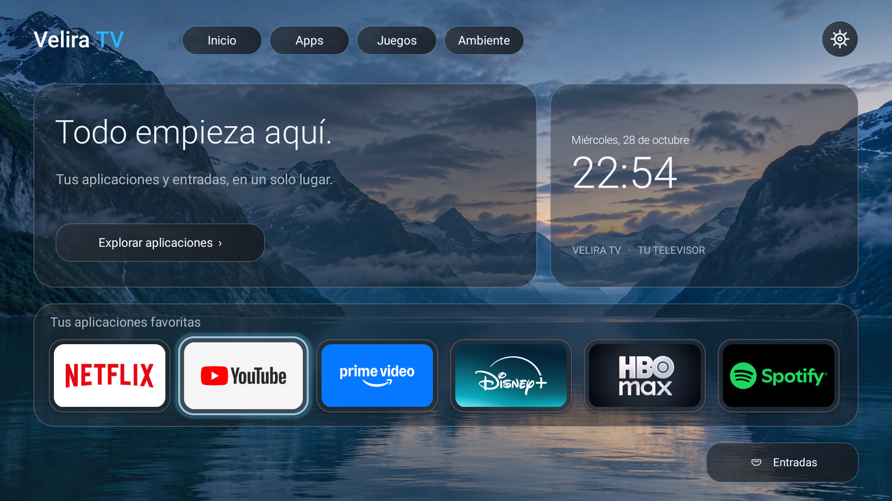
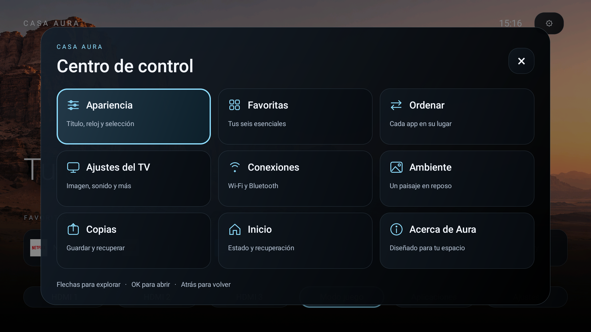
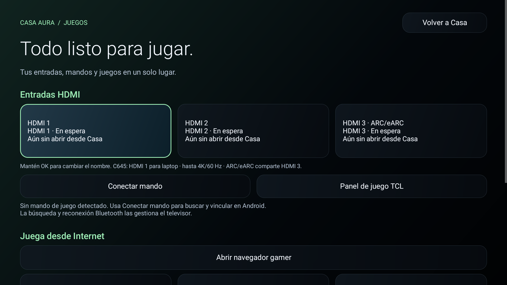
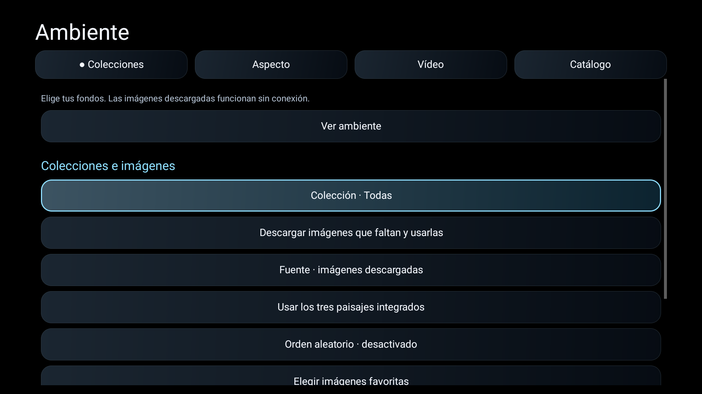

# Velira TV

Antes Casa Aura TV. La versión pública disponible es **0.10.0**; el código en desarrollo **0.11** incorpora la marca Velira, los tres diseños adaptados y las correcciones de medios. El código está disponible en el repositorio; el APK estable continúa en 0.10.0 mientras se revisa la estabilidad. [Estado y evidencia de la candidata](docs/VELIRA-011-LOCAL.es.md).

**Un inicio tranquilo para tu televisor.** Launcher independiente para Android TV y Google TV, con favoritas, accesos HDMI y salvapantallas ambiente.

Desarrollado y probado específicamente en **TCL 50C645 · Android 11 · V652**. El proyecto y sus versiones iniciales se llamaban Casa TV Launcher; se conserva el repositorio y el paquete para mantener actualizaciones y configuración.

[Resultados reales en C645](docs/RESULTADOS-C645.es.md) · [Inicio estable con TCL Guard](docs/TCL-C645-GUARD.es.md) · [Historial visual](docs/HISTORIAL-VISUAL.es.md)

[Descargar APK y versiones](https://github.com/arleyjesus/velira-tv/releases) · [Instalación](docs/INSTALL.es.md) · [Compatibilidad](docs/COMPATIBILITY.md) · [English](README.en.md)

[Ver los tres modos y sus cambios](docs/MODOS-VISUALES.es.md)

## Qué ofrece

- Inicio sin anuncios propios ni cuentas.
- Diseños Clásico, Moderno e Inmersivo; hasta seis favoritas guardadas y ordenables con el mando.
- Biblioteca completa al bajar desde una app, con tarjetas reutilizables.
- Centro de Juegos: HDMI con nombres y estado, mandos, GeForce NOW y juegos web.
- Control de Contenido adaptable de TCL con permiso opcional, y acceso a sus ajustes originales.
- Ambiente con paisajes integrados, colecciones online, favoritos y vídeo MP4 opcional.
- Efectos Desactivados/Bajos/Medios/Altos, título/reloj y animación de selección configurables.
- Copias locales y restauración de favoritas y apariencia.
- Salvapantallas ambiente independiente, sin PIN.

**No necesita Projectivy, root ni desactivar el inicio de Google.** No elimina anuncios dentro de otras aplicaciones ni modifica sus interfaces.

## Estado del proyecto

**Versión actual: v0.10.0.** [Ambiente online](docs/AMBIENTE-ONLINE.es.md): colecciones, favoritas, imágenes descargadas y vídeo MP4 a petición. Nuevo acabado negro/azul, efectos regulables y [Centro de Juegos](docs/CENTRO-JUEGOS.es.md) con entradas, accesorios y navegador a petición. Panel de Contenido adaptable de TCL con lectura, cambio y deshacer. [Guía de imagen](docs/IMAGEN-TCL.es.md). Conserva los tres diseños, el ambiente y la galería de GitHub. [Guía de la galería](docs/GALERIA.es.md). [Guía de diseños y ambiente](docs/DISENOS-AMBIENTE.es.md). Probada en la C645 de referencia; los paneles nativos de TCL siguen pendientes de mejoras y no se anuncia una aceleración general del sistema.

[Laptop, HDMI y modo Juego](docs/JUGAR-C645.es.md)

Se desarrolló y probó en un **TCL 50C645 con Android 11 y firmware V8-R51MT05-LF1V652.021344**. El manifiesto permite Android 8.0/API 26 o posterior, pero otros modelos y versiones aún no están validados.

Los accesos a ajustes y entradas incluyen comportamiento específico de TCL. La interfaz está actualmente en español. Las tres entradas HDMI están fijadas en esta versión. Consulta la [matriz de compatibilidad y limitaciones](docs/COMPATIBILITY.md) antes de instalar.

## Instalar o actualizar

1. Descarga la APK de una [versión publicada](https://github.com/arleyjesus/velira-tv/releases).
2. Instálala y ábrela primero como una aplicación normal.
3. Prueba navegación, aplicaciones, imagen, sonido y entradas antes de cambiar Inicio.
4. Si quieres que Home abra Casa, activa **Casa Aura · Botón Inicio** en Accesibilidad.

La [guía completa](docs/INSTALL.es.md) explica ADB, actualización conservando datos, autoarranque TCL, ambiente y cómo volver al inicio anterior. **No se necesita aplicar una lista de debloat para usar Casa.**

Mantén **OK** sobre una favorita para editarla. En **Ajustes** encontrarás ordenación, apariencia y copias de configuración.

## Ambiente

[Ambiente online: uso, fuentes y límites](docs/AMBIENTE-ONLINE.es.md)

Casa incluye tanto una vista previa manual como un servicio de salvapantallas Android. Su selección y activación dependen del firmware. No es una pantalla de bloqueo: al suspenderse realmente el TV, la pantalla se apaga.

## Privacidad y permisos

Desde 0.7 la APK solicita Internet para fondos; desde 0.9 también se usa al abrir juegos web. Inicio no hace peticiones. Ambiente usa imágenes locales; el vídeo se conecta solo al probarlo o activar esa opción. Los sitios visitados reciben tu IP y datos habituales del navegador. El permiso de estado de red permite respetar Solo Wi-Fi; no solicita acceso general al almacenamiento. Favoritas y preferencias permanecen en el dispositivo. El servicio opcional de Accesibilidad recibe únicamente cambios de ventana de los inicios de Google TV y Projectivy, sin capacidad de leer su contenido. [Detalle de privacidad](docs/PRIVACY.md).

## Rendimiento

Casa usa vistas Android nativas y recursos locales. La muestra de navegación estabilizada de v0.2.0 registró 0 fotogramas lentos de 171 y mediana de 5 ms en el TV probado. La versión anterior también navegaba bien: **esto no demuestra una aceleración general del televisor**. [Método y resultados](docs/COMPATIBILITY.md#rendimiento).

## Compilar y contribuir

El proyecto usa Java y herramientas oficiales del SDK, sin dependencias externas de aplicación ni Gradle en esta versión. [Compilación y firma](docs/BUILD.md) · [Contribuir](CONTRIBUTING.md) · [Hoja de ruta](ROADMAP.md) · [Historial](CHANGELOG.md) · [Evolución visual](docs/HISTORIAL-VISUAL.es.md).

Para informar de un fallo, abre un [issue](https://github.com/arleyjesus/velira-tv/issues) con modelo, Android, firmware y pasos de reproducción. No publiques cuentas, IP, credenciales, claves ni volcados completos del TV.

## Licencia y créditos

Código y recursos originales bajo [MIT](LICENSE): puedes usarlos, modificarlos y compartirlos conservando el aviso de licencia. Los paisajes se crearon con asistencia de IA. Los nombres e iconos de las aplicaciones pertenecen a sus titulares; Casa obtiene los iconos de las apps instaladas y no redistribuye sus APK. [Créditos](NOTICE.md).

Proyecto independiente, sin afiliación con TCL, Google, Projectivy ni las plataformas de streaming.
