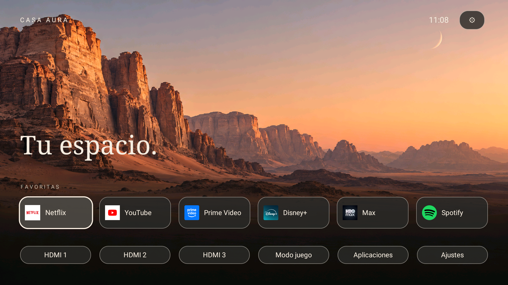
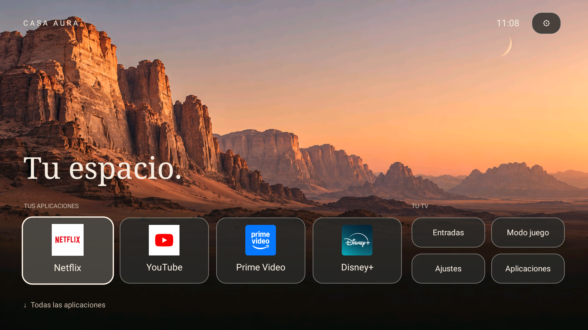
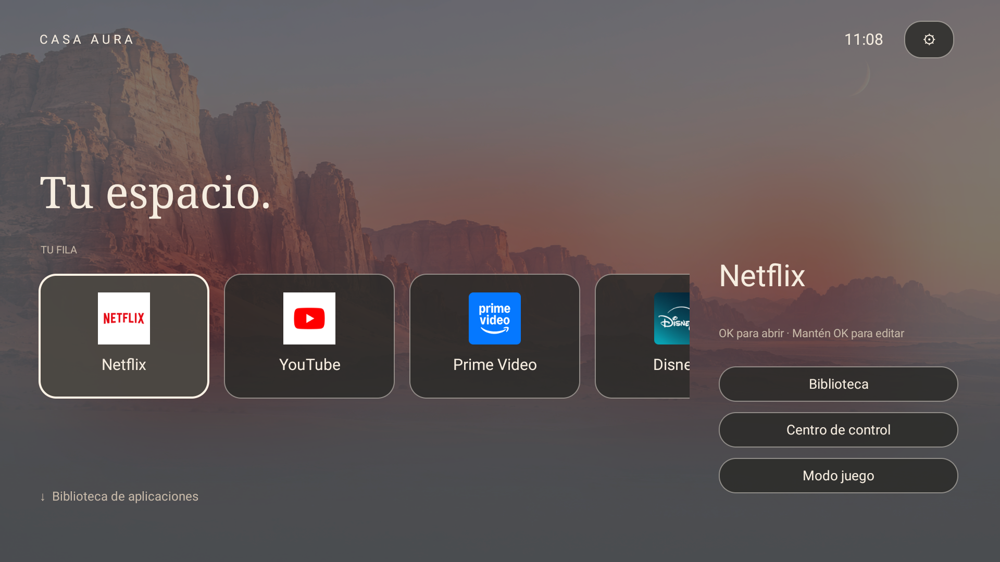
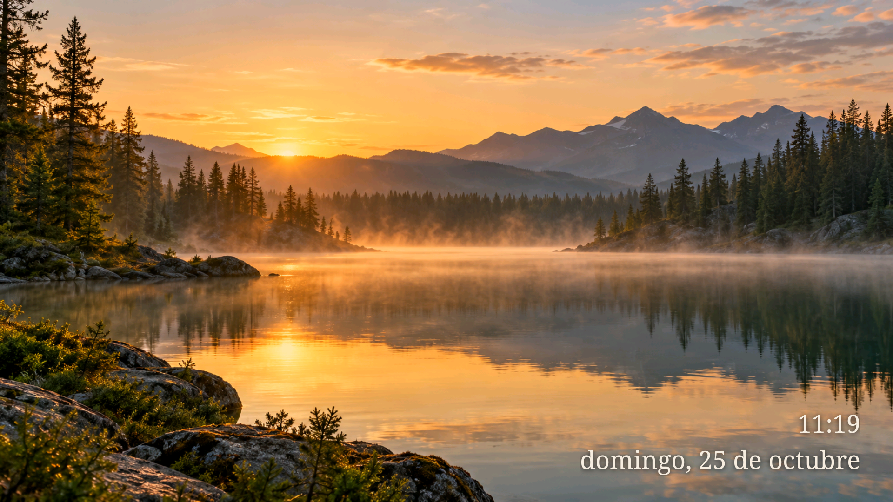

# Diseños y modo ambiente · 0.6

Probado en TCL 50C645, Android 11, V8-R51MT05-LF1V652.021344. Los cambios pertenecen a Casa; no sustituyen los paneles ni el procesador de imagen de TCL.

## Elegir presentación

Abre **Ajustes → Apariencia → Diseño**. La elección se guarda y se incluye en las copias locales.

| Diseño | Presentación |
| --- | --- |
| Clásico | Seis favoritas en una fila y otra fila de entradas y controles. |
| Moderno | Cuatro tarjetas grandes y accesos agrupados a la derecha. Es el predeterminado. |
| Inmersivo | Carrusel horizontal de seis favoritas, información contextual lateral y un fondo de color suavizado obtenido del icono seleccionado. |

El desenfoque inmersivo se calcula sobre una miniatura de 48 × 27 píxeles al cambiar de aplicación, con una caché de cuatro fondos. No reproduce avances, descarga carteles ni aplica desenfoque continuo. En los tres diseños se conserva la biblioteca completa y la navegación con mando. Los seis favoritos guardados siguen disponibles al cambiar de diseño.

## Ambiente

Abre **Ajustes → Ambiente**. Vista previa y salvapantallas comparten estas opciones:

- Tres paisajes integrados: desierto, fiordo y bosque. Funcionan sin Internet.
- Tiempo por imagen: 30, 60, 120, 300 o 600 segundos; predeterminado 120.
- Corte directo o disolución; predeterminada disolución de 1 segundo.
- Duración de disolución: 0,5, 1 o 2 segundos.
- Movimiento opcional con zoom de 0, 2 o 4 %. Desactivado de fábrica.
- Imagen inicial según la hora, opcional. Después continúa la rotación normal; no es una recomendación por IA.

La decodificación se hace fuera del hilo de interfaz. Dos vistas permiten la transición; se libera la imagen saliente al terminar y se detienen temporizadores y movimiento al salir. El paisaje compartido del inicio permanece en su caché. Esto limita recursos, pero no equivale a una medición de consumo mínimo en todos los televisores.

OK o Atrás cierra la vista previa. La selección y activación automática del salvapantallas se gestionan en Android y dependen del firmware. Al suspenderse realmente el TV se apaga la pantalla.

## Contenido remoto: siguiente etapa

La versión 0.6 sigue sin permiso de Internet. Desde 0.7 existe descarga manual desde el catálogo de GitHub: consulta la [guía de galería](GALERIA.es.md). El ZIP publicado se mantiene para compartir; no se importan ZIP arbitrarios.

Para una galería futura: catálogo JSON pequeño, enlaces HTTPS, tamaño y SHA-256 por archivo, descarga a petición, caché limitada y retorno a los fondos integrados sin red. El repositorio puede guardar catálogo y capturas; los packs versionados pueden adjuntarse a [GitHub Releases](https://docs.github.com/en/repositories/releasing-projects-on-github/about-releases). GitHub Pages sería una opción para servir el catálogo, sin necesidad de activarlo ahora. Evitar un sondeo permanente y no guardar vídeos en el historial Git.

El vídeo por URL requiere reproductor y pruebas propias: MP4 o HLS/DASH con códecs compatibles y decodificación por hardware cuando esté disponible, búfer acotado, parada al salir y retorno a imagen si falla la red. La compatibilidad real depende del dispositivo y formato. Véase [formatos de Media3](https://developer.android.com/media/media3/exoplayer/supported-formats).

Un enlace de YouTube no es una URL directa de vídeo. La primera integración razonable sería abrir su aplicación; un reproductor integrado necesita evaluar su API oficial, controles y comportamiento con el mando. No se implementa extracción de streams. Véase [YouTube IFrame Player API](https://developers.google.com/youtube/iframe_api_reference).

## Imagen e IA del televisor

TCL anuncia [AIPQ Engine 3.0 para C645](https://www.tcl.com/latin/en/tvs/c645). Esa ficha no documenta una API pública para que un launcher controle el procesador. Casa no modifica AIPQ, retroiluminación, HDR, modo Juego ni calibración. El acceso de brillo e imagen abre los ajustes originales.

El color obtenido del icono y la selección por horario son funciones locales sencillas. No necesitan un modelo de IA ni aprovechan automáticamente la IA de TCL. El escalado actual de fondos es el de una vista Android; no se anuncia como superresolución. Un brillo adaptativo propio necesitaría comprobar sensores, API y efectos por entrada antes de plantear cambios.

## Validación y límites

Se comprobaron los tres selectores y sus pantallas en la C645, la instalación conservando favoritas y opciones anteriores, y pruebas de valores válidos e inválidos para los nuevos ajustes. El manifiesto conserva el contrato sin Internet y el filtro limitado de Accesibilidad. Las medidas antiguas de RAM y fluidez no se trasladan a esta versión. Los tirones de los paneles nativos de TCL siguen sin resolverse.

