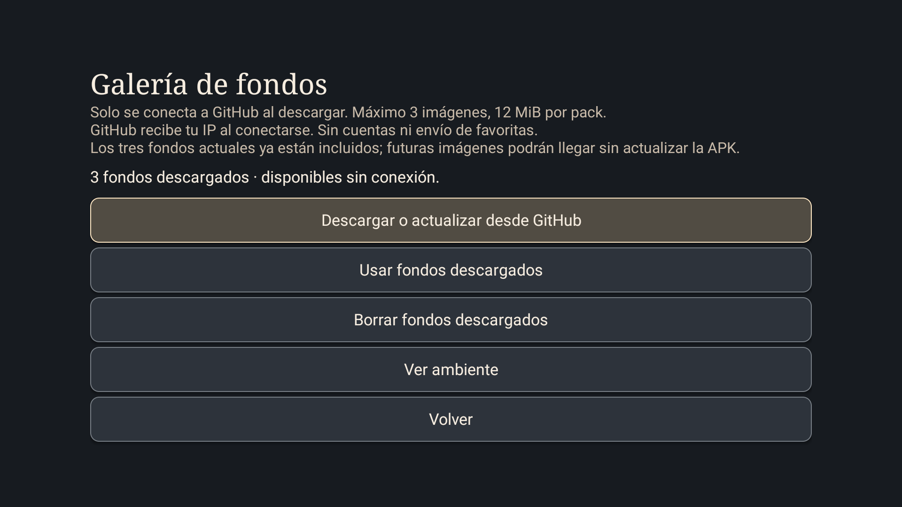

# Galería de fondos · 0.7

Entra en **Ajustes → Ambiente → Galería de fondos**.

1. Pulsa **Descargar o actualizar desde GitHub**. La aplicación comprueba todo el pack antes de sustituir el anterior.
2. Pulsa **Usar fondos descargados** para activarlo. Descargar no cambia automáticamente tu selección.
3. **Ver ambiente** abre la vista previa. Después de descargar, el ambiente lee archivos locales.
4. **Usar fondos integrados** cambia de fuente sin borrar la descarga.
5. **Borrar fondos descargados** libera ese espacio y selecciona los tres paisajes integrados.

La primera galería contiene los mismos paisajes que la APK. Esta versión incorpora el mecanismo para actualizar el catálogo en el futuro sin reinstalar Casa; no añade paisajes nuevos ni vídeo.

## Conexión y límites

La APK 0.7 añade permiso de Internet. Abrir Inicio, Ambiente o la pantalla de galería no inicia conexiones. Solo el botón de descarga consulta el catálogo público y sus imágenes en raw.githubusercontent.com. GitHub recibe la IP y los metadatos normales de una petición HTTP; Casa no envía favoritas ni información del TV. Al salir se solicita la cancelación y se cierra la conexión activa. No hay tareas periódicas, sondeos ni descargas automáticas.

El pack admite de una a tres imágenes PNG, hasta 4 MiB cada una y 4096 × 2160 píxeles de área máxima por imagen. Se validan nombre, URL HTTPS dentro del repositorio y etiqueta de versión, bytes exactos, SHA-256, formato y dimensiones. No se siguen redirecciones. El hash comprueba integridad respecto al catálogo; no es una firma independiente de quien mantiene el repositorio.

Los fondos están en almacenamiento privado. Un pack ocupa como máximo 12 MiB; al actualizar pueden coexistir temporalmente el pack actual y su sustituto, hasta 24 MiB de imágenes más catálogos y metadatos del sistema de archivos. Se borra el anterior tras completar el cambio. Las descargas incompletas se limpian al finalizar o en el siguiente intento. Si un proceso se interrumpe justo al reemplazar archivos, se intenta recuperar el pack anterior.

Si falta un pack válido, el ambiente usa los fondos integrados. Si una imagen local no se puede decodificar, se utiliza una integrada. No hace falta borrar datos de Casa ni cambiar ajustes internos de TCL.

## Publicar otro pack

El catálogo se mantiene en `resources/ambient-catalog-v1.json` de la rama main. Cada entrada contiene `file`, `bytes`, `sha256` y `url`. Las imágenes deben estar en `assets/` de una etiqueta con formato vX.Y.Z del mismo repositorio. Publica primero los archivos y la etiqueta; actualiza después el catálogo. Así cada descarga apunta a una versión identificable.

La versión 0.7 no importa ZIP ni URL arbitrarias. Las copias de configuración guardan la elección de fuente, pero no incluyen los archivos descargados. Restaurar esa preferencia en otro TV sin pack mantiene el respaldo integrado hasta descargar uno.

## Pruebas y límites conocidos

Probado en TCL 50C645, Android 11, V652: descarga de tres imágenes, activación y vista previa, cancelación de una actualización, borrado y regreso a los fondos integrados. Pruebas automatizadas: restricciones de URL, rutas, tamaño, cancelación, SHA-256, opciones y contrato del APK. No se desconectó la red del TV para simular un corte ni se midió el consumo durante sesiones prolongadas. La galería no corrige los tirones de los paneles nativos de TCL.

La implementación usa [HTTPS fuera del hilo de interfaz](https://developer.android.com/develop/connectivity/network-ops/connecting) y [lectura de dimensiones antes de decodificar imágenes](https://developer.android.com/topic/performance/graphics/load-bitmap).

