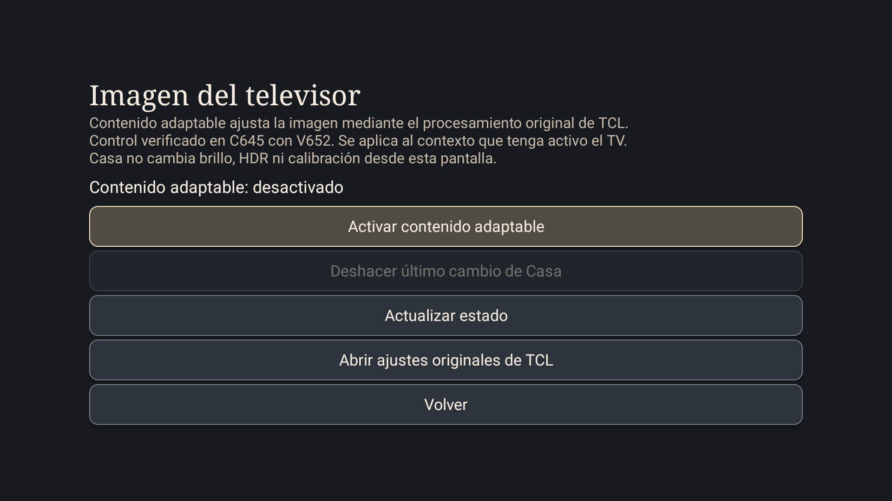

# Imagen del televisor · 0.8

Abre **Centro de control → Ajustes del TV → Imagen de TCL · contenido adaptable**.

Casa muestra el estado del control original de TCL. Permite activarlo, desactivarlo, actualizar la lectura y deshacer el último cambio realizado desde Casa. Se verificó en **TCL 50C645, Android 11, V8-R51MT05-LF1V652.021344**. Otros modelos y firmwares todavía no están validados.

## Primer uso

1. Pulsa **Permitir controles de TCL**.
2. Android pregunta si Casa Aura TV puede mostrar fragmentos de Configuración. Pulsa **Permitir** y deja sin marcar la casilla para cualquier aplicación.
3. Al volver, Casa consulta el estado. No se cambia la imagen al abrir esta pantalla ni al conceder el permiso.
4. Pulsa **Activar** o **Desactivar contenido adaptable** para solicitar un cambio. Espera el resultado confirmado.
5. **Deshacer último cambio de Casa** restaura el valor anterior que Casa guardó antes de enviar su última modificación. Si ya coincide, el botón queda deshabilitado.

El botón **Abrir ajustes originales de TCL** mantiene disponible el panel del fabricante. En equipos sin el control verificado, Casa muestra que no está disponible y permite usar los ajustes originales.

## Qué modifica

Es el interruptor nativo **Contenido adaptable**, dentro de Foto/Imagen inteligente de TCL. No es una capa de oscurecimiento del launcher. El procesamiento sigue siendo el de TCL y puede adaptar la imagen según su implementación.

La selección corresponde al contexto activo del televisor. No se ha comprobado su persistencia por entrada ni por SDR, HDR o Dolby Vision. Abrir esta pantalla puede pausar la aplicación de vídeo anterior: todavía no es un panel superpuesto para ajustar mientras se reproduce Netflix o YouTube. No se promete aplicación universal a todas las fuentes.

Este módulo no ofrece deslizadores propios de brillo, contraste, saturación ni calibración. Tampoco permite programar AIPQ o cargar una IA propia. La configuración dinámica por horario, fuente o contenido sigue pendiente.

## Cómo se protege el cambio

Se usa la integración Slice de la aplicación instalada de TCL, con su permiso de Android. No se incluyen bibliotecas del fabricante, claves de autorización, comandos de shell ni permisos privilegiados.

Casa acepta únicamente la fila `adaptive_picture_content_0`, habilitada, con una sola acción de tipo toggle creada por `com.tcl.settings`. El estado se lee del indicador `selected` que entrega TCL. Una estructura desconocida deja el control sin acceso.

La acción de TCL alterna el valor actual; no acepta un estado objetivo. Por eso Casa vuelve a leer antes de actuar, evita enviar si el valor ya coincide, espera la entrega y verifica el resultado. No hay reintentos automáticos. Si no puede confirmar el cambio, bloquea los botones de modificación hasta una nueva lectura manual.

El valor anterior se guarda en las preferencias privadas `TclPictureUndo`, antes del envío. Se conserva para deshacer, pero no se incluye en las copias de favoritas/apariencia: es un ajuste del TV actual, no una preferencia portable a otro equipo. Deshacer afecta al contexto activo; no lo uses como calibración general para otras fuentes.

No hay vigilancia de aplicaciones, lectura de fotogramas, servicio adicional ni conexiones de Internet en este módulo. Consultar y modificar ocurre solo al usar la pantalla. No se activa ni desactiva automáticamente en Inicio, arranque o reposo.

## Retirar el acceso y volver al panel original

Puedes seguir usando el panel original sin abrir el módulo de Casa. Si el firmware ofrece gestión de permisos de fragmentos, revócalo allí. Desinstalar Casa también retira su acceso; exporta antes tus favoritas si necesitas conservarlas. Desactivar el servicio Botón Inicio es independiente de este permiso.

## Validación

En la C645 de referencia se probó: estado sin permiso, solicitud oficial, lectura tras concederlo, OFF → ON confirmado, Deshacer → OFF restaurado, reapertura conservando el estado y el permiso. Se comparó la configuración exportada antes/después: favoritas, preset y ambiente sin cambios. Pasaron las pruebas de la política del control y la revisión del APK. No se midió rendimiento de vídeo ni se repitieron pruebas prolongadas de suspensión.

