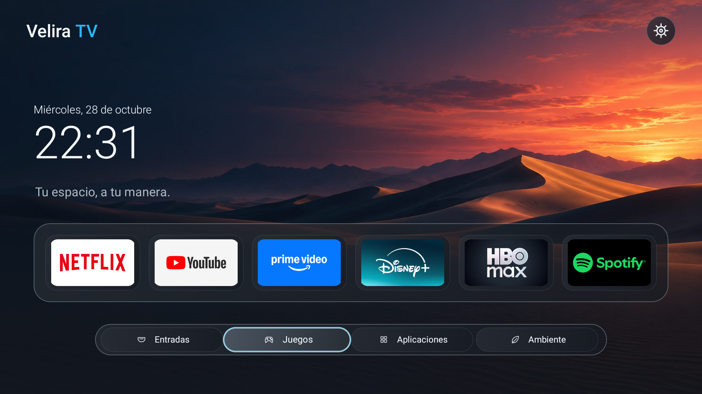
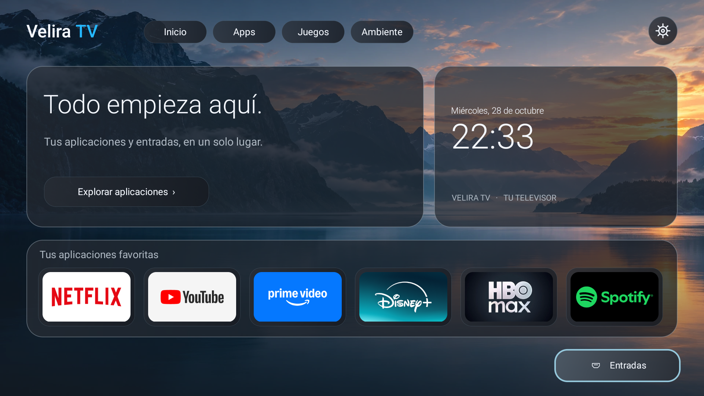
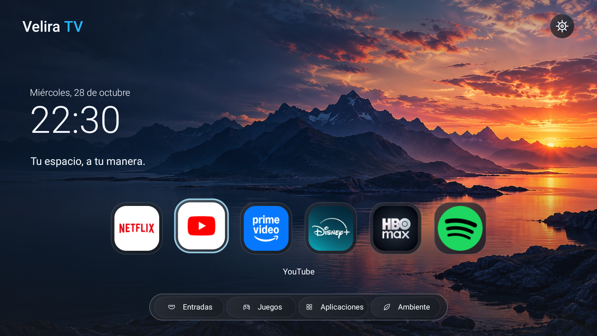

# Los tres modos de Velira TV

## Rediseño 0.11 · 28 de octubre de 2026

Código en desarrollo, sin release estable. Capturas reales de la TCL 50C645, Android 11/V652, interfaz 1920×1080. Se conserva el paquete y la configuración existente.

### Clásico

Fecha, reloj y seis favoritas dentro de una bandeja grafito. Abajo: Entradas, Juegos, Aplicaciones y Ambiente. Ajustes aparece una sola vez, arriba.

### Moderno

Dashboard con bienvenida y reloj separado, seis favoritas más altas y Entradas como único acceso inferior. Apps, Juegos y Ambiente permanecen en el encabezado. El botón Explorar es la acción de la tarjeta de bienvenida y abre la misma biblioteca que Apps; no hay una segunda barra de accesos.

### Inmersivo

Seis iconos locales centrados sin bandeja, nombre de la selección debajo, paisaje completo y menú inferior compacto. Se elimina la superposición de color adaptativo para conservar el fondo natural.

## Efectos

| Nivel | Selección | Duración | Elevación del dock inmersivo |
| --- | --- | --- | --- |
| Desactivados | Borde fijo, sin escala | Sin animación | Ninguna |
| Bajos | Escala 1,025 | 140 ms | 2 unidades de diseño |
| Medios | Escala 1,05 | 190 ms | 4 unidades |
| Altos | Escala 1,065 | 220 ms | 6 unidades |

Todos conservan el contorno del foco. La opción Animación de selección permite desactivar el movimiento. Son transformaciones nativas y superficies estáticas, sin desenfoque continuo ni bucles de animación.

## Implementación y comprobaciones

HomeLayouts reúne composición, recorte de imágenes y conexiones de foco; AuraTheme centraliza grafito, radios y bordes; HomeShade aporta gradientes discretos; MainActivity gestiona escala/elevación y conserva las preferencias anteriores.

Pasaron las pruebas de opciones y redirección Home, compilación firmada y verificación del APK. Se recorrieron los tres presets desde Ajustes y se capturaron en la TV. Se comprobó selección con flechas y retorno desde una app; no se repitieron pruebas prolongadas. No se certifican todos los niveles en todas las resoluciones ni se afirma una aceleración del sistema.

Los banners e iconos son los reales: los fondos blancos incluidos por sus autores no se reemplazan ni se recolorean. No se añaden Perfiles, Buscar ni datos ficticios. No hay atenuación automática por inactividad ni reflejos animados; Ambiente conserva su propio ciclo. La incidencia previa de system_server sigue abierta y bloquea una release estable.

## Historial

- [Primera adaptación 0.11](VELIRA-011-LOCAL.es.md): bandeja compartida y carrusel anterior.
- Rediseño actual: modos diferenciados, sin HDMI individuales en Inicio, seis favoritas en Moderno y dock flotante en Inmersivo.
- [Versiones anteriores](HISTORIAL-VISUAL.es.md).
