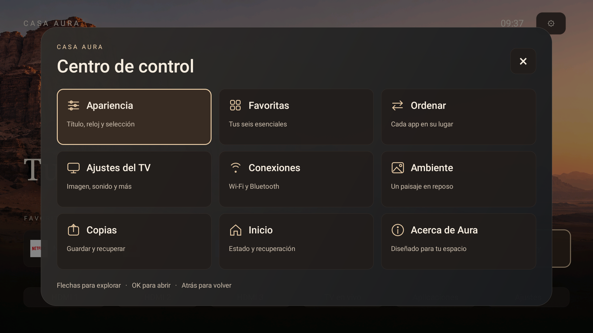

# Casa Aura TV: resultados en TCL 50C645

Actualizado: **25 de octubre de 2026**. Android 11 / V8-R51MT05-LF1V652.021344, 2 GiB de RAM. Registro de un solo equipo, no certificación para toda la familia C645.

## Qué se consiguió

| Cambio | Resultado comprobado | Límite |
| --- | --- | --- |
| Launcher propio, independiente | Favoritas, HDMI, ambiente y ajustes propios sin Projectivy ni permiso de Internet | Los controles de imagen/sonido siguen perteneciendo a TCL |
| Caché de iconos acotada, fondo compartido y carga de apps fuera del hilo principal | Casa 0.2 mantuvo muestras de navegación con mediana de 5 ms por frame | No demuestra aceleración del sistema completo |
| Servicio de Inicio 0.3 | Menor espera configurada y bloqueo de duplicados más corto | No se estableció una mejora consistente de latencia total de Home |
| Protección individual de Guard | Casa en listas activa/persistente después de reinicio; tres retornos desde YouTube y suspensión/reactivación comprobados | Ajuste externo al APK; ver [guía de Guard](TCL-C645-GUARD.es.md) |
| Retirada selectiva autorizada | Hola, Proton VPN, Mercado Play, Projectivy y QIYI retirados, con APK respaldados; otras apps de streaming conservadas | Quitar una app inactiva no demuestra ganar FPS |
| Casa Aura 0.4 preliminar | Centro de control de nueve tarjetas, iconos propios y paneles secundarios adaptados a su contenido | Rediseña Casa, no los paneles propietarios del firmware |

## Ajustes nativos: lo que sigue pendiente

Tres aperturas de `com.android.tv.settings/.MainSettings` por condición:

| Contexto | Tiempos `am start -W` | Mediana |
| --- | --- | --- |
| YouTube reproduciendo, estado confirmado | 573 / 239 / 294 ms | 294 ms |
| YouTube pausado | 203 / 151 / 155 ms | 155 ms |
| Desde Casa, vídeo pausado | 144 / 125 / 143 ms | 143 ms |

Son muestras pequeñas, no aleatorizadas; el sistema llevaba poco tiempo iniciado. Sugieren coste adicional durante reproducción, no una causa única. El tiempo de actividad no equivale a tiempo desde pulsar el mando ni garantiza que todos los fotogramas estén dibujados.

Una traza posterior conservó una apertura de aproximadamente 410 ms; el hilo principal estuvo unos 74 ms ejecutándose, 59 ms listo esperando CPU y 277 ms dormido/esperando. No identifica por sí sola el servicio esperado. El búfer perdió parte del inicio y no se confirmó reproducción activa al empezar esa captura, por lo que no se utiliza para anunciar una mejora.

La barra rápida inferior y el panel lateral requieren identificación y medición separadas. No se extrapolan los resultados del menú completo. Los contadores de frames nativos resultaron acumulativos entre tandas y sus porcentajes no se comparan como muestras independientes.

## RAM: cómo interpretar las cifras

Lecturas puntuales de `dumpsys meminfo tv.casa.launcher`, todas del **proceso de Casa**, no de toda la TV:

| Lectura | PSS | RSS | Swap PSS |
| --- | ---: | ---: | ---: |
| 0.3 antes del rediseño, ya residente | 28.066 KiB | 79.620 KiB | 4.666 KiB |
| 0.4 durante la primera exploración de pantallas/apps | 71.198 KiB | 169.872 KiB | 218 KiB |
| 0.4 tras la revisión final del panel y regreso a Inicio | 33.459 KiB | 130.236 KiB | 201 KiB |

PSS reparte memoria compartida; RSS la contabiliza de otra manera. Las condiciones y la antigüedad de los procesos no coinciden: **no calculamos un porcentaje antes/después con esas filas**. El último PSS es aproximadamente 32,7 MiB; no es una promesa de consumo máximo.

Una publicación que afirma «282 → 96 MB» y «3 veces más rápido» necesita indicar dispositivo, firmware, proceso medido, métrica y tarea. La captura compartida no contiene ese protocolo. No puede usarse como resultado esperado ni como comparación con los 2 GiB totales de esta TV.

Para la siguiente comparación controlada se conservarán firmware, vídeo, resolución, tiempo tras arrancar y secuencia del mando; se separarán proceso del launcher, memoria global y latencias de Inicio/paneles. No se vaciará RAM ni forzará recolección para mejorar artificialmente una cifra.

## Cambios externos al launcher

En este equipo se redujeron `window_animation_scale` y `transition_animation_scale` a 0,5; `animator_duration_scale` quedó sin modificar. Eso acorta transiciones, no demuestra mayor capacidad de procesamiento. Se deshabilitaron individualmente TCL BI y OverseasAppShow; otras deshabilitaciones ya existían. Ninguno de esos cambios es requisito ni se aplica automáticamente al instalar Casa.

La IA de imagen «Foto Inteligente → Contenido adaptable» se observó activada y se conservó. No se demostró que provoque los tirones. No se deshabilitaron Guard, Google TV, setup, códecs, entradas, búsqueda, actualizador, DRM ni servicios de imagen y sonido.

## Comparación visual

Se conserva el paisaje y la paleta cálida de Casa. La referencia de tvOS se limita a jerarquía, espacios, tarjetas y foco claro: no se copian gráficos de Apple ni se añade desenfoque en tiempo real. El diseño usa vistas nativas e iconos dibujados, sin imágenes adicionales ni servicios.

Referencias de contexto, no benchmarks de nuestra TV: [TV Detox](https://github.com/Ansub/tv-detox), [CleanYourTV](https://github.com/Gathin23/cleanyourtv), [foco y selección en las guías de Apple](https://developer.apple.com/design/human-interface-guidelines/focus-and-selection/).
