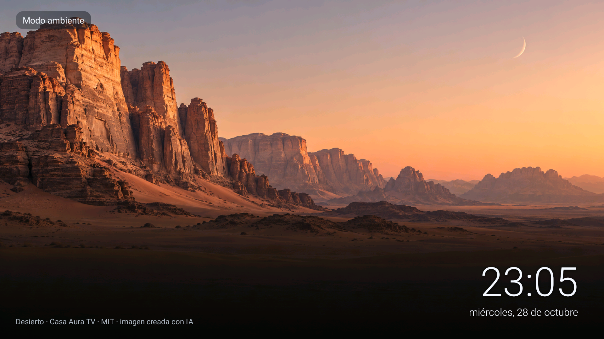
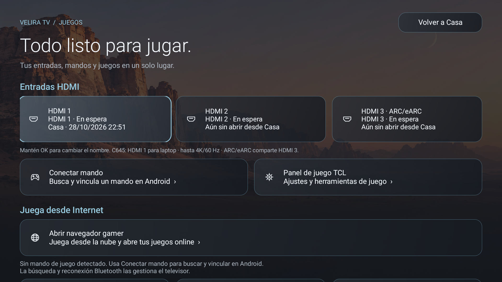

# Ambiente y Juegos · candidata 0.11

28 de octubre de 2026. Capturas reales de TCL 50C645, Android 11/V652, interfaz 1920×1080. Etapa de desarrollo, sin nueva release estable.

## Ambiente

Reloj ligero grande y fecha separada más pequeña, ambos abajo a la derecha. Créditos reales siempre visibles abajo a la izquierda. Insignia discreta y degradado inferior menos intenso. Se conservan fondos, colecciones, filtros del usuario, vídeo y movimiento configurado. Flechas izquierda/derecha cambian fotos; arriba muestra ayuda; OK y Atrás siguen cerrando la vista previa. La ayuda se oculta tras cuatro segundos; el salvapantallas sigue siendo no interactivo.

## Juegos

Fondo existente con grafito oscuro, cabecera Velira, tres HDMI con estados y nombres conservados, tarjetas de mandos y herramientas, y navegador gamer. Sitios web, favoritos, recientes, juegos instalados y borrado del historial permanecen debajo mediante desplazamiento. No está disponible el fondo aislado con el mando de la referencia: se reutiliza el paisaje anterior, sin añadir otra imagen.

## Código y coste

AmbientScene separa los tamaños de hora/fecha, conserva dos vistas de foto y la precarga existente. La navegación no encola otra decodificación si hay una pendiente y descarta callbacks antiguos. La ayuda usa un callback cancelable, no un sondeo. El reloj conserva actualización por minuto; stop cancela tareas y animaciones. AmbientActivity conserva OK/Atrás.

GameModeActivity conserva TvInputManager, InputManager, selección y nombres HDMI. El fondo se carga fuera del hilo UI en el trabajador existente y reutiliza Assets. GameUi reutiliza superficies y HomeGlyph para pequeños iconos creados una vez al construir los botones. Transformaciones de foco de 160 ms y escala 1,025 solo cuando están habilitadas. Sin blur, dependencias, servicios ni peticiones nuevas en estas pantallas. CinematicShade calcula el gradiente únicamente al cambiar de tamaño. Los tres inicios no se rediseñan aquí.

## Comprobaciones y límites

Pasaron las suites Home, opciones, galería, imagen TCL, juegos y online, compilación firmada y contrato del APK. Capturas revisadas en TV, navegación y desplazamiento con flechas, diálogo de nombre HDMI abierto sin guardar cambios. Ambiente abrió con la configuración existente; se probaron flechas e información. La hora de la captura corresponde al reloj del TV. No se esperó una hora para validar cada cambio de minuto.

Muestra puntual de dibujo tras reset: 123 fotogramas, 2 lentos (1,63 %), mediana 6 ms, p95 9 ms, p99 46 ms; GPU mediana 11 ms, p95 15 ms. Incluye transiciones de ventana. No es benchmark comparativo, prueba de ausencia de fugas ni aceleración general de TCL.

Las rutas Android/TCL y del navegador se conservan en código; no se certifica aquí una sesión de juego, emparejamiento físico, señal de los tres puertos ni todas las pantallas nativas. El volcado de accesibilidad devolvió raíz nula en varios intentos: se usaron capturas reales y no se interpretaron volcados antiguos como evidencia nueva. La incidencia previa de Android sigue abierta. No se publica una release estable.
